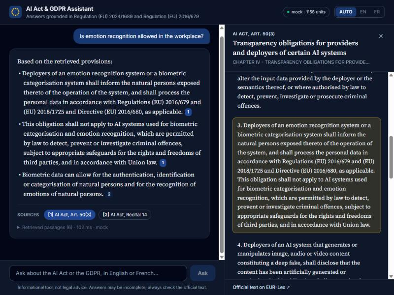
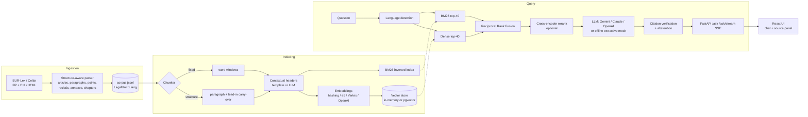
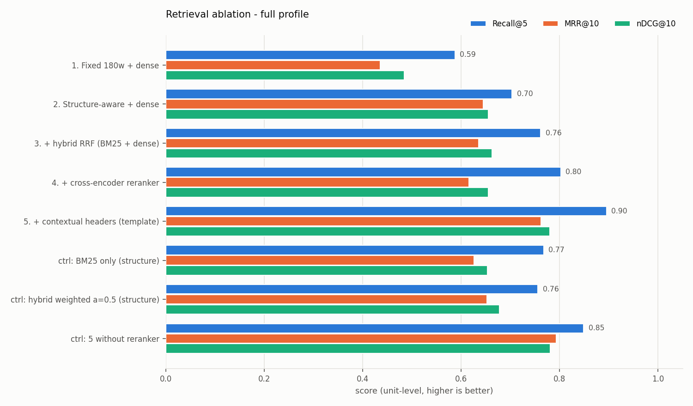

# eu-ai-act-rag

**Bilingual (FR/EN) retrieval-augmented assistant over the EU AI Act (Regulation (EU) 2024/1689)
and the GDPR (Regulation (EU) 2016/679) - built around a documented retrieval ablation.**

[](https://github.com/manal-he/eu-ai-act-rag/actions/workflows/ci.yml)
 

> **Not legal advice.** This is an engineering project. Answers can be incomplete or wrong;
> the only authentic texts are those published in the Official Journal on
> [EUR-Lex](https://eur-lex.europa.eu).

The interesting part of this repository is not that it answers questions about the AI Act - it
is the **evaluation**: a hand-written golden set of 92 FR/EN questions with gold article ids, and
an ablation runner that changes one retrieval decision at a time (chunking, hybrid fusion,
reranking, contextual headers) and measures what each change does to Recall@k, MRR and nDCG.


<sub>Offline mode (extractive mock answerer, hashing vectors, full downloaded corpus): every
claim carries a citation chip; clicking it opens the official text with the cited paragraph
highlighted.</sub>

- [Problem](#problem) - [Architecture](#architecture) - [Design decisions](#design-decisions--trade-offs)
- [Quickstart (offline, zero keys)](#quickstart-offline-zero-keys) - [Real providers](#using-real-providers)
- [Evaluation](#evaluation) - [Results](#results) - [Limitations](#limitations) - [Roadmap](#roadmap)

## Problem

Legal questions are unforgiving for RAG:

- **Citations are the product.** "Article 5(1)(f)" is the answer as much as the prose is; an
  uncited claim about a prohibition or a fine is worse than no answer.
- **The structure carries meaning.** A paragraph like "2. The risk management system shall
  comprise the following steps" does not say which regulation, article or actor it concerns.
  Fixed-size chunks routinely cut an enumeration from the sentence that introduces it.
- **Two languages, one law.** French and English versions are equally authentic; users ask in
  either and expect the answer (and the quoted text) in their language.
- **Knowing when not to answer.** Questions about tax law, the DSA or US executive orders must be
  refused, not answered from the nearest-looking EU text.

## Architecture



| Layer | Implementation | Swappable via |
|---|---|---|
| Ingestion | `ingest/download.py` (EUR-Lex, Cellar fallback), `ingest/parser.py` | `euai ingest` |
| Chunking | `chunking/fixed.py`, `chunking/structure.py`, `chunking/contextual.py` | `CHUNKING`, `CONTEXTUAL_HEADERS` |
| Sparse | own Okapi BM25 (`retrieval/retrievers.py`) | - |
| Dense | `embeddings/providers.py`: hashing (offline), `intfloat/multilingual-e5-small`, Vertex `text-multilingual-embedding-002`, OpenAI | `EMBEDDING_PROVIDER` |
| Vector store | numpy exact cosine, Postgres + pgvector (HNSW) | `VECTOR_STORE` |
| Fusion | RRF (k=60) or min-max weighted | `RETRIEVER`, `FUSION` |
| Reranker | sentence-transformers cross-encoder, Cohere Rerank, Vertex AI ranking API | `RERANKER` |
| Generation | Gemini on Vertex (google-genai), Claude (anthropic SDK), OpenAI, deterministic `mock` | `LLM_PROVIDER` |
| API | FastAPI: `/health`, `/search`, `/ask`, `/ask/stream` (SSE), `/units/{id}` | - |
| UI | Vite + React + TypeScript + Tailwind | - |

## Design decisions & trade-offs

**Chunking for legal text.** The retrieval unit is the *paragraph* of an article (recital,
annex block), because that is the unit people cite. Over-long paragraphs - Article 5(1) lists
eight prohibited practices, Article 3 has 68 definitions - are split on their enumerated
points, and the paragraph's lead-in ("The following AI practices shall be prohibited:") is
copied into every piece, so point (h) still says what it enumerates. Each chunk keeps exact
metadata (regulation, article, paragraph, language), which makes citation labels like
`AI Act, Art. 5(1)` deterministic rather than generated. The naive baseline (180-word windows
with 30-word overlap over the flattened text) is kept as ablation step 1.

**Contextual chunk headers.** Inspired by Anthropic's *contextual retrieval*: a header such as
`EU AI Act > Chapter III - High-risk AI systems > Section 2 > Article 9: Risk management system >
paragraph 2` is prepended *for indexing only* (BM25 and embeddings see it; the user and the LLM
see the raw text). Legal hierarchy is explicit, so a free template captures most of the value;
an LLM-written variant (`CONTEXTUAL_HEADERS=llm`, cached on disk) is implemented for comparison.

**Why hybrid.** Lexical and semantic retrieval fail differently on this corpus. BM25 nails
exact terms ("72 hours", "CE marking", "Annex III") and article vocabulary; dense retrieval
handles paraphrase ("can my employer analyse my emotions?" vs. "inferring emotions of a natural
person in the areas of workplace"). Hybrid retrieval is cheap insurance against both failure
modes. Measured here (see [Results](#results)), hybrid clearly beats dense-only but only ties
BM25-only - with a stronger embedder or more colloquial questions the balance may shift, which is
exactly why both stay behind one interface.

**RRF vs. weighted fusion.** BM25 scores are unbounded and query-dependent, cosine scores are
bounded and compressed; any weighted sum needs per-query normalisation and a tuned alpha that
silently drifts when the embedding model changes. Reciprocal Rank Fusion only uses ranks, has one
robust parameter (k=60) and needs no calibration. Weighted min-max fusion is kept as a control
row in the ablation so the claim is measured, not asserted - on this golden set the two tie, so
the argument for RRF is robustness, not a higher score.

**Reranker latency cost.** A cross-encoder reads (question, passage) jointly - far more accurate
than bi-encoder similarity but one forward pass per candidate. It only sees the top-40 of the
first stage, and the ablation reports p50/p95 latency per step so the quality gain can be
weighed against the cost. Measured on a laptop CPU: ~18 s p50 per query (vs ~50 ms without),
with higher Recall@5 but lower MRR - so it is off by default; on Cloud Run the Vertex ranking API
is the practical option.

**Bilingual handling.** Both language versions are indexed; the question language is detected
(stop-word vote, overridable with `lang`) and retrieval is filtered to that language, so a French
question is answered from - and cites - the French text. Gold labels are language-independent
unit ids (`gdpr:art_17`), so the same golden item measures FR and EN retrieval identically.
`multilingual-e5` embeds both languages in one space, so `LANGUAGE_FILTER=all` enables
cross-lingual retrieval if wanted.

**Mandatory citations and abstention.** The model writes plain text with `[n]` markers (which
streams token by token); markers are then resolved against the passages actually supplied and
parsed into a pydantic `Answer`. Out-of-range markers are dropped; an answer left with zero valid
citations is converted into an abstention (`abstain_reason="no_valid_citation"`); the model can
also emit `INSUFFICIENT_CONTEXT`, which the streaming layer holds back so it never flashes in the
UI. Six out-of-scope questions in the golden set test this.

**Offline by default.** `LLM_PROVIDER=mock` is a deterministic *extractive* reader: it consumes
the same prompt as the real providers and returns the best-overlapping sentences with their
markers. It is not a language model, but it lets the API, streaming, citation checks, UI and CI
run with zero keys. Likewise `EMBEDDING_PROVIDER=hashing` is feature hashing - a lexical
stand-in that exercises the dense code path, explicitly labelled as non-semantic in reports.

## Quickstart (offline, zero keys)

Requirements: Python 3.11, Node 22 (UI), optionally Docker.

```bash
python -m venv .venv && source .venv/bin/activate     # Windows: .venv\Scripts\activate
pip install -e ".[dev]"
pytest                                                # offline suite, no network, no keys

# API on the committed fixture (36 provisions x FR/EN)
uvicorn eu_ai_act_rag.api.main:app_factory --factory --port 8000
curl -s localhost:8000/ask -H 'content-type: application/json' \
     -d '{"question": "Dans quel délai notifier une violation de données ?"}'

# UI (another terminal) -> http://localhost:5173
cd ui && npm install && npm run dev
```

Full corpus (downloads ~5 MB of XHTML from EUR-Lex at runtime, git-ignored):

```bash
euai ingest                                  # -> data/processed/corpus.jsonl (1,156 units)
export CORPUS_PATH=data/processed/corpus.jsonl
```

Docker (API + Postgres/pgvector + UI, still zero keys):

```bash
docker compose up --build     # UI http://localhost:8080 - API docs http://localhost:8000/docs
```

`make help` lists the shortcuts (`make install`, `make ingest`, `make dev`, `make test`,
`make lint`, `make eval`, `make eval-full`, ...).

## Using real providers

Copy `.env.example` to `.env` and set only what you use:

| Goal | Settings |
|---|---|
| Gemini on Vertex AI | `LLM_PROVIDER=gemini`, `GOOGLE_CLOUD_PROJECT=YOUR_PROJECT_ID`, `pip install -e ".[vertex]"`, `gcloud auth application-default login` |
| Claude | `LLM_PROVIDER=anthropic`, `ANTHROPIC_API_KEY=...`, `pip install -e ".[anthropic]"` |
| OpenAI | `LLM_PROVIDER=openai`, `OPENAI_API_KEY=...`, `pip install -e ".[openai]"` |
| Local semantic embeddings + reranker | `EMBEDDING_PROVIDER=local`, `RERANKER=local`, `pip install -e ".[local]"` |
| Vertex embeddings / ranking | `EMBEDDING_PROVIDER=vertex`, `RERANKER=vertex` |
| pgvector | `VECTOR_STORE=pgvector`, `DATABASE_URL=postgresql://...`, `pip install -e ".[pg]"` |

Cloud Run deployment (Artifact Registry, least-privilege service account, Secret Manager for
third-party keys, placeholders only): see [`deploy/cloudrun/`](deploy/cloudrun/README.md).

## Evaluation

**Golden set** - [`evals/golden/golden_v1.jsonl`](evals/golden/golden_v1.jsonl): 92 items
(53 EN / 39 FR) written by the author from the structure of both regulations: 52 AI Act, 29 GDPR,
5 cross-regulation (e.g. AI Act Art. 27(4) FRIA vs. GDPR Art. 35 DPIA), 6 out-of-scope.
Each item has a question, the gold unit ids (article / annex) and a short reference answer.
Gold ids were checked to exist in the parsed corpus; the legal content of reference answers is
**v1 and has not been reviewed by a lawyer**.

**Retrieval metrics** are computed at the *legal-unit* level: retrieved chunks are mapped to their
article / annex and de-duplicated in rank order, so five paragraphs of Article 5 count once and
fixed-size vs. structure-aware chunking are compared on the same footing. Recall@k (share of gold
units in the top k), MRR@10, binary nDCG@10. Retrieval is filtered to the question's language.
Unanswerable items are excluded from retrieval metrics.

**Generation metrics** (`--generation`): answer rate on answerable items, abstention rate on
out-of-scope items, citation precision (share of cited units that are gold), faithfulness and
correctness from a judge. `LLMJudge` grades with a fixed rubric through any provider;
`LexicalJudge` is a token-overlap proxy so the pipeline runs in CI.

**Judge calibration.** An LLM judge is a measurement instrument and is not trusted until it has
been compared with human labels: [`evals/calibration/`](evals/calibration/README.md) defines the
protocol (>= 50 stratified rows, two annotators, Cohen's kappa + Spearman, acceptance at kappa >=
0.6, checks for self-preference, verbosity and language bias) and ships the agreement script.
**This calibration has not been run yet**, so no LLM-judge score is reported below.

**Ablation runner** - `python evals/run_ablation.py --profile offline|full [--generation]`:

| Profile | Corpus | Steps |
|---|---|---|
| `offline` (CI, zero keys) | committed fixture | fixed+BM25 -> structure+BM25 -> + headers -> + hybrid RRF (hashing vectors) |
| `full` | `euai ingest` corpus | 1 fixed+dense -> 2 structure+dense -> 3 + hybrid RRF -> 4 + cross-encoder -> 5 + contextual headers, plus controls (BM25 only, weighted fusion, step 5 without reranker) |

Each run writes `report.md`, `results.json` (per-query rankings included) and `ablation.png` to
`evals/results/<profile>/`.

## Results

All numbers below come from runs executed for this commit; the full reports (setup, per-language
breakdown, per-query rankings) are committed under [`evals/results/`](evals/results/). They are
measured on a 92-item single-author golden set - read them as deltas, not as absolute quality.

### Full corpus - `python evals/run_ablation.py --profile full --generation`

Config: downloaded corpus (1,156 FR+EN units), 86 answerable questions, retrieval filtered to the
question language, `intfloat/multilingual-e5-small` embeddings (in-memory exact cosine),
`cross-encoder/mmarco-mMiniLMv2-L12-H384-v1` reranking the top-40, RRF k=60. Latency measured on
a Windows laptop CPU (no GPU). Report: [`evals/results/full/report.md`](evals/results/full/report.md).



| Step | R@1 | R@5 | R@10 | MRR@10 | nDCG@10 | p50 latency |
|---|---:|---:|---:|---:|---:|---:|
| 1. Fixed 180-word windows + dense | 0.262 | 0.587 | 0.692 | 0.436 | 0.484 | 47 ms |
| 2. Structure-aware + dense | 0.500 | 0.704 | 0.773 | 0.645 | 0.655 | 45 ms |
| 3. + hybrid RRF (BM25 + dense) | 0.442 | 0.762 | 0.849 | 0.636 | 0.663 | 47 ms |
| 4. + cross-encoder reranker | 0.355 | 0.802 | 0.889 | 0.615 | 0.656 | 17.9 s |
| 5. + contextual headers (template) | 0.558 | **0.895** | **0.919** | 0.762 | 0.780 | 20.3 s |
| ctrl: BM25 only (structure) | 0.395 | 0.767 | 0.855 | 0.626 | 0.653 | 1 ms |
| ctrl: hybrid weighted, alpha=0.5 | 0.448 | 0.756 | 0.861 | 0.652 | 0.677 | 48 ms |
| ctrl: step 5 without reranker | **0.581** | 0.849 | 0.889 | **0.793** | **0.781** | 49 ms |

What the ablation says:

1. **Structure-aware chunking is the largest single win** (R@5 +0.12, MRR +0.21 over fixed
   windows): fixed windows straddle articles and get attributed to the wrong one.
2. **Contextual headers are the second** (R@5 +0.09, MRR +0.15 on top of step 4; a similar gain
   without the reranker). Paragraphs that never name their article or topic become findable.
3. **Hybrid helps dense but not BM25 here.** RRF lifts R@5 over dense alone (+0.06) yet roughly
   ties BM25 alone (0.762 vs 0.767). With a small multilingual embedder, legal vocabulary is
   carried by the lexical side - and the golden set, written by someone who knows the texts'
   vocabulary, probably favours BM25 (see Limitations).
4. **RRF vs weighted fusion is a tie on this set** (R@5 0.762 vs 0.756, MRR 0.636 vs 0.652). RRF
   stays the default for its lack of tuning, not because it scored higher.
5. **The cross-encoder trades precision at the top for recall, at a large cost.** It raises R@5 and
   R@10 (+0.04 each) but lowers R@1 and MRR, and costs ~18 s per query on CPU (40 pairs x 512
   tokens) vs ~50 ms without. The best configuration for an interactive app on this hardware is
   **structure + headers + hybrid RRF without reranker**; the reranker would need a GPU, a
   smaller candidate set, or a managed ranking API, and a stronger (legal-domain or
   bge-reranker-v2-m3) model to be worth it.
6. Language: step 5 reaches R@5 0.900 on EN and 0.889 on FR questions - no large FR/EN gap.

End-to-end with the **offline extractive answerer** (`mock`) on the best configuration
(`ctrl: step 5 without reranker`): answer rate on answerable questions 1.000, **abstention on
out-of-scope questions 5/6** (the DSA question was answered from AI Act recitals 118/120, which
do mention Regulation (EU) 2022/2065 - a genuine failure of score-free abstention), citation
precision 0.609. Faithfulness (1.000) and correctness (0.311) come from the lexical proxy judge
and are **not** quality claims - an extractive answerer is faithful by construction. LLM
generation + calibrated LLM-judge numbers: not run yet (`make eval-gen` once keys and the
calibration are in place).

### Offline fixture - `python evals/run_ablation.py --profile offline --generation` (zero keys, CI)

Config: committed fixture (36 provisions x FR/EN = 72 units), 53 answerable questions, BM25 and
hashing vectors (lexical stand-in, not semantic). Report:
[`evals/results/offline/report.md`](evals/results/offline/report.md).

| Step | R@1 | R@5 | R@10 | MRR@10 | nDCG@10 |
|---|---:|---:|---:|---:|---:|
| A. Fixed 180w + BM25 | 0.660 | 0.849 | 0.887 | 0.795 | 0.795 |
| B. Structure-aware + BM25 | 0.698 | 0.877 | 0.943 | 0.839 | 0.848 |
| C. B + contextual headers (template) | **0.811** | 0.896 | 0.943 | **0.914** | **0.899** |
| D. C + hybrid RRF (BM25 + hashing vectors) | 0.717 | **0.906** | 0.934 | 0.843 | 0.847 |

The fixture has ~16x fewer units than the full corpus (72 vs 1,156), so absolute scores are much
higher; the ordering of the chunking and header effects is the same as on the full corpus. Fusing
in the non-semantic hashing vectors hurts MRR - expected, and a reminder that hybrid only pays off when
the second retriever brings different signal.

## Limitations

- **Single-author golden set.** 92 questions written by one person who also built the system:
  phrasing may unconsciously match the retriever, and reference answers are unreviewed. Treat
  absolute numbers as indicative; the *deltas between steps* are the signal. Small sample: one
  question is ~1.2-2 points of Recall@5 at this size.
- **Vocabulary bias.** Questions were written by someone who knows the texts, so they reuse the
  regulations' wording more than real users would; this likely flatters BM25 relative to dense
  retrieval. A set of colloquial paraphrases is on the roadmap.
- **Hardware-specific latency.** Latencies are from one CPU laptop run; only their order of
  magnitude transfers.
- **Judge bias.** No calibrated LLM-judge numbers yet (see above); the lexical proxy measures
  overlap, not legal correctness.
- **Unit-level relevance only.** Gold labels are articles, not paragraphs; a retriever returning
  the right article but the wrong paragraph is not penalised.
- **Corpus scope.** AI Act + GDPR only - no delegated/implementing acts, guidelines, codes of
  practice or case law, and no consolidated amendments.
- **Parsing.** The parser targets the current Official Journal XHTML (CONVEX) markup; tables in
  annexes are flattened to text.
- **Mock generation.** The offline answerer extracts sentences; it cannot synthesise across
  provisions.
- **Prompt injection / exposure.** Retrieved context is only the official texts (no user
  uploads), but the question itself is untrusted input to the LLM. Citation markers are checked
  against the supplied passages, yet free-text answers from a real LLM are not otherwise filtered,
  and the API has no auth or rate limiting of its own - keep it private (as in
  `deploy/cloudrun/`) or put it behind a gateway.

## Roadmap

- Lawyer review of golden set v1 -> v2; paragraph-level gold labels; harder multi-hop questions.
- Run and publish the judge calibration; then report LLM-judge faithfulness / correctness for
  Gemini and Claude.
- LLM-generated contextual headers vs. template headers on the full corpus.
- Query rewriting for colloquial questions; FR/EN stemming in BM25.
- Consolidated versions and delegated acts; recital-aware answers (recitals as interpretive
  context, articles as the cited rule).
- Tracing (OpenTelemetry) and per-request cost accounting.

## Repository layout

```
src/eu_ai_act_rag/   ingest/ chunking/ embeddings/ retrieval/ llm/ generation/ evaluation/ api/
evals/               golden set, ablation runner, calibration protocol, committed results
data/fixtures/       small FR/EN excerpt for tests and the offline demo (+ attribution)
ui/                  Vite + React + TypeScript + Tailwind client
docker/ deploy/      multi-stage non-root images, Cloud Run manifests (placeholders)
```

## Licence and attribution

Code: MIT, (c) 2026 Manal Herradi ([@manal-he](https://github.com/manal-he)).
Legal texts: (c) European Union, https://eur-lex.europa.eu, reused under Commission Decision
2011/833/EU. Only a small excerpt is committed ([attribution](data/fixtures/ATTRIBUTION.md));
full texts are downloaded at runtime and never committed.
