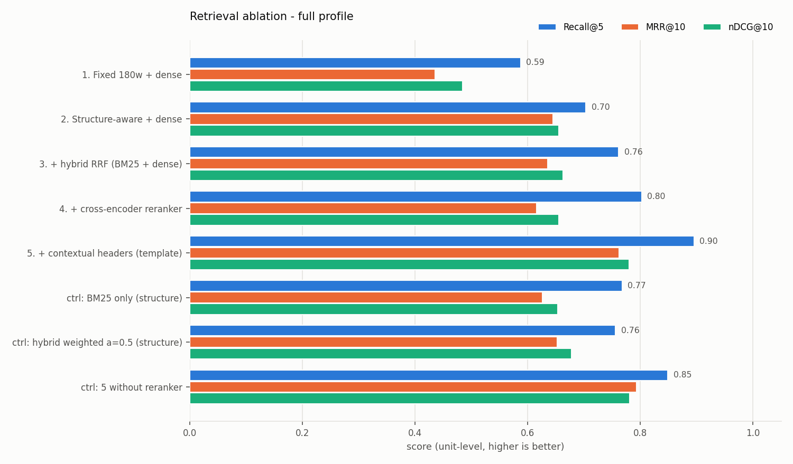

# Retrieval ablation - full profile

_Generated 2026-11-07 11:18 UTC by `evals/run_ablation.py` - numbers below are produced by this run, not edited._

## Setup

- **profile**: full
- **corpus**: `data/processed/corpus.jsonl` - 1156 units (FR+EN)
- **golden set**: `golden_v1.jsonl` - 92 items (v1, single author, unreviewed)
- **embedder**: local (intfloat/multilingual-e5-small)
- **reranker**: local (cross-encoder/mmarco-mMiniLMv2-L12-H384-v1)
- **fusion**: RRF k=60 over top-40 per retriever (weighted: min-max, alpha=0.5)
- **python / platform**: 3.11.5 / Windows-10-10.0.26200-SP0

## Retrieval (unit level, language-filtered to the question language)

| Step | Chunks | R@1 | R@5 | R@10 | MRR@10 | nDCG@10 | p50 ms | p95 ms |
|---|---:|---:|---:|---:|---:|---:|---:|---:|
| 1. Fixed 180w + dense | 1978 | 0.262 | 0.587 | 0.692 | 0.436 | 0.484 | 46.6 | 58.4 |
| 2. Structure-aware + dense | 2837 | 0.500 | 0.704 | 0.773 | 0.645 | 0.655 | 45.4 | 56.6 |
| 3. + hybrid RRF (BM25 + dense) | 2837 | 0.442 | 0.762 | 0.849 | 0.636 | 0.663 | 47.0 | 58.6 |
| 4. + cross-encoder reranker | 2837 | 0.355 | 0.802 | 0.889 | 0.615 | 0.656 | 17867.4 | 23396.8 |
| 5. + contextual headers (template) | 2837 | 0.558 | 0.895 | 0.919 | 0.762 | 0.780 | 20271.4 | 26021.8 |
| ctrl: BM25 only (structure) | 2837 | 0.395 | 0.767 | 0.855 | 0.626 | 0.653 | 1.1 | 2.1 |
| ctrl: hybrid weighted a=0.5 (structure) | 2837 | 0.448 | 0.756 | 0.861 | 0.652 | 0.677 | 48.1 | 58.5 |
| ctrl: 5 without reranker | 2837 | 0.581 | 0.849 | 0.889 | 0.793 | 0.781 | 48.6 | 63.0 |

### By question language (Recall@5 / MRR@10)

| Step | EN R@5 | EN MRR | FR R@5 | FR MRR |
|---|---:|---:|---:|---:|
| 1. Fixed 180w + dense | 0.570 | 0.424 | 0.611 | 0.452 |
| 2. Structure-aware + dense | 0.700 | 0.629 | 0.708 | 0.666 |
| 3. + hybrid RRF (BM25 + dense) | 0.760 | 0.639 | 0.764 | 0.631 |
| 4. + cross-encoder reranker | 0.790 | 0.611 | 0.819 | 0.621 |
| 5. + contextual headers (template) | 0.900 | 0.765 | 0.889 | 0.758 |
| ctrl: BM25 only (structure) | 0.760 | 0.635 | 0.778 | 0.614 |
| ctrl: hybrid weighted a=0.5 (structure) | 0.720 | 0.643 | 0.806 | 0.664 |
| ctrl: 5 without reranker | 0.860 | 0.819 | 0.833 | 0.757 |

Queries scored: **86** answerable golden items whose gold units are all present in the indexed corpus (unanswerable items are excluded from retrieval metrics). Latency = retrieval (+ rerank) per query on this machine, embeddings of documents cached, query embedding included.

## Generation (end-to-end)

Config: retrieval = `ctrl: 5 without reranker`, LLM = `mock`, judge = `lexical-proxy`.

| Answerable | Unanswerable | Answer rate (answerable) | Abstain rate (unanswerable) | Faithfulness | Correctness | Citation precision | p50 ms |
|---:|---:|---:|---:|---:|---:|---:|---:|
| 86 | 6 | 1.000 | 0.833 | 1.000 | 0.311 | 0.609 | 46.6 |

> The lexical judge is a token-overlap proxy used so this runs offline. An extractive answerer is faithful by construction, so faithfulness here is a sanity check, not a quality claim. Use `--judge llm` for real scores, after calibrating the judge (evals/calibration/README.md).
