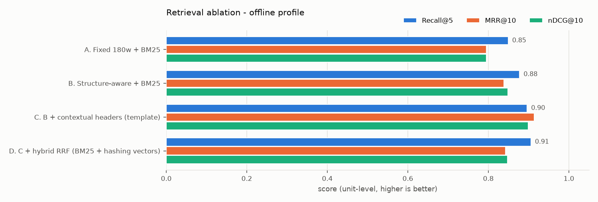

# Retrieval ablation - offline profile

_Generated 2026-11-07 11:20 UTC by `evals/run_ablation.py` - numbers below are produced by this run, not edited._

## Setup

- **profile**: offline
- **corpus**: `data/fixtures/corpus_fixture.jsonl` - 72 units (FR+EN)
- **golden set**: `golden_v1.jsonl` - 92 items (v1, single author, unreviewed)
- **embedder**: hashing (feature hashing: a lexical stand-in, NOT semantic)
- **reranker**: none
- **fusion**: RRF k=60 over top-40 per retriever (weighted: min-max, alpha=0.5)
- **python / platform**: 3.11.5 / Windows-10-10.0.26200-SP0

## Retrieval (unit level, language-filtered to the question language)

| Step | Chunks | R@1 | R@5 | R@10 | MRR@10 | nDCG@10 | p50 ms | p95 ms |
|---|---:|---:|---:|---:|---:|---:|---:|---:|
| A. Fixed 180w + BM25 | 316 | 0.660 | 0.849 | 0.887 | 0.795 | 0.795 | 0.5 | 0.9 |
| B. Structure-aware + BM25 | 460 | 0.698 | 0.877 | 0.943 | 0.839 | 0.848 | 0.5 | 0.8 |
| C. B + contextual headers (template) | 460 | 0.811 | 0.896 | 0.943 | 0.914 | 0.899 | 0.6 | 0.9 |
| D. C + hybrid RRF (BM25 + hashing vectors) | 460 | 0.717 | 0.906 | 0.934 | 0.843 | 0.847 | 1.8 | 2.2 |

### By question language (Recall@5 / MRR@10)

| Step | EN R@5 | EN MRR | FR R@5 | FR MRR |
|---|---:|---:|---:|---:|
| A. Fixed 180w + BM25 | 0.840 | 0.816 | 0.857 | 0.777 |
| B. Structure-aware + BM25 | 0.860 | 0.820 | 0.893 | 0.855 |
| C. B + contextual headers (template) | 0.860 | 0.924 | 0.929 | 0.905 |
| D. C + hybrid RRF (BM25 + hashing vectors) | 0.880 | 0.925 | 0.929 | 0.769 |

Queries scored: **53** answerable golden items whose gold units are all present in the indexed corpus (unanswerable items are excluded from retrieval metrics). Latency = retrieval (+ rerank) per query on this machine, embeddings of documents cached, query embedding included.

## Generation (end-to-end)

Config: retrieval = `C. B + contextual headers (template)`, LLM = `mock`, judge = `lexical-proxy`.

| Answerable | Unanswerable | Answer rate (answerable) | Abstain rate (unanswerable) | Faithfulness | Correctness | Citation precision | p50 ms |
|---:|---:|---:|---:|---:|---:|---:|---:|
| 53 | 6 | 1.000 | 1.000 | 1.000 | 0.279 | 0.711 | 3.3 |

> The lexical judge is a token-overlap proxy used so this runs offline. An extractive answerer is faithful by construction, so faithfulness here is a sanity check, not a quality claim. Use `--judge llm` for real scores, after calibrating the judge (evals/calibration/README.md).
